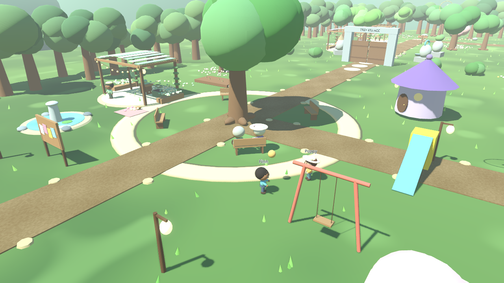

# MNKISWAN: Cozy World — Days Together

Godot **4.7.2**, version **0.4.0**. A playable 3D village built around daily life with Mnki and Swan: **31 villagers with work, play, rest and sleep routines; a lantern market; and optional shared rituals**. Both characters remain playable and Swan can fly. This continues the owner's uploaded Claude project and earlier revisions.

Read the [complete project audit](docs/PROJECT_AUDIT.md), [daily-life guide](docs/DAYS_TOGETHER.md), and [validation report](docs/VALIDATION.md). This remains a procedural prototype with production art, deeper social behavior and other work outstanding.

## Download and play

- [Windows x64 game ZIP](https://github.com/mnkiswan/mnkiswan_cozy_world/raw/refs/heads/main/downloads/MNKISWAN_Cozy_World_Windows_x64.zip)
- [Linux x64 game ZIP](https://github.com/mnkiswan/mnkiswan_cozy_world/raw/refs/heads/main/downloads/MNKISWAN_Cozy_World_Linux_x64.zip)
- [Godot 4.7.2 source ZIP](https://github.com/mnkiswan/mnkiswan_cozy_world/raw/refs/heads/main/downloads/MNKISWAN_Cozy_World_Source_0.4.0.zip)

Extract the whole ZIP first. On Windows, run `MNKISWAN_Cozy_World.exe`; Godot is not required to play. On Linux, run `./MNKISWAN_Cozy_World.x86_64` (use `chmod +x MNKISWAN_Cozy_World.x86_64` if your extractor removes executable permissions).

To edit, extract the **source ZIP**, open Godot **4.7.2**, choose **Import**, select `project.godot`, then press **F5**. Both desktop export presets are included; install the matching 4.7.2 export templates to build locally. The Compatibility renderer supports OpenGL 3.3 hardware.

## Controls

| Input | Action |
| --- | --- |
| WASD / arrows | Move relative to the camera |
| Mouse / wheel | Look around / zoom |
| C | Switch between Mnki and Swan on the ground |
| F, as Swan | Take off; toggle landing / hover while airborne |
| Space | Jump on foot; rise while flying |
| Ctrl | Descend while flying |
| Shift | Run / fly faster |
| E | Talk, gather, farm, fish and interact |
| R | Change seed |
| Tab / I, J, M | Inventory, journal, map |
| H | Our days together / Village day |
| Esc | Pause, close a menu, cancel fishing or finish a shared ritual |

Actions can be rebound in Settings. Flight has no stamina penalty. Release movement to hover; press F for a gentle landing. Land before switching. Mnki waits on the ground while Swan flies and rejoins after she lands. Low ceilings block takeoff, solid roofs stop ascent, and flight stays within the village boundary and a 24 m altitude limit.

Follow the six gold sky-feather rings. Each pays five coins once; finishing the route pays twenty more and adds a journal note. Remaining feathers appear on the map. This optional route does not replace the village story.

Both characters share inventory, coins, quests and tools. Saves remember the selected character; saving during flight records the last safe ground position. Existing saves from the uploaded Claude build default to Mnki when they lack a character field. Saves from the earlier, different Codex prototype are not migrated.

## What's changed



[See the daily-life screenshots](docs/screenshots/DAYS_TOGETHER.md).

- **Daily routines:** children play catch/use the swing, elders occupy park benches, a couple dates in the flower garden, and farmers work then take breaks. Neighbours walk home and retire offscreen at their doors.
- **Night market:** lanterns and ten vendors/visitors gather from 18:00 to midnight. Children retire at 20:00 and most adults at 21:00. Normal vendor counters open 07:00–00:00. The player's own fruit stall stays self-service.
- **Shared life:** appreciation, breathing and dancing anywhere nearby; tea, picnic, garden date, sky-watching, tending and market supper at six marked places. Both heroes take part. Move/Esc to finish early. Completed moments create memories, with no currency cost or relationship penalty.
- **UI and pace:** H opens Together/Village day; inspect resident status and location, find pink hearts on the map, use Quiet HUD, and choose 12/24/36/60-minute days (default 36).
- **Animation and collision:** frame-rate-independent pose blending, daily gestures/held props, improved seated poses, working house collision for both heroes, and explicit sleep-hour synchronization.
- All **13 gathering places and 39 activities** from Living Village remain. Teal map diamonds mark gathering places; Journal → Village life tracks activities and friendship visits.
- Stand quietly together for **35 seconds** to hear occasional two-way conversations about love, kindness and wisdom. They remain interruptible and can be disabled in Settings.

The uploaded video exceeded the attachment tool's **32 MiB transfer limit**, so its frames could not be inspected. These additions follow the user's requested direction and the existing thirteen-region design; they are not a reconstruction of unseen video scenes. See [Living Village notes](docs/LIVING_VILLAGE.md) for scope and implementation details.

The previous revision's character and flight improvements remain:


- Both Mnki and Swan are playable, with one camera/input owner and the other character as companion.
- Swan has controllable, collision-aware flight, expanding feather wings, banking, hovering and landing. The HUD shows character, flight controls and altitude.
- Curved hair locks, curled ends on Swan's long hair, layered feathers, an open hood shell, pleated skirt geometry, richer eyes, facial details, cuffs, thumbs and crossed sneaker laces. Their signature accessories and outfits remain intact.
- Softer materials, improved close-up shadows, muted terrain, distant hills and drifting clouds.
- Fishing pauses while menus are open. Saves protect the last valid backup from a corrupt primary. Interaction height is revalidated at use time. Cosmetic gestures no longer block takeoff or movement.
- The uploaded project's thirteen regions, farming, fishing, animal care, trading, home decoration, quests, journal, settings and day cycle remain available.

## Development and verification

```bash
GODOT_BIN=/path/to/Godot_v4.7.2-stable_linux.x86_64 ./tools/test.sh
./tools/build.sh
```

Tests use temporary save directories. The original gameplay, flight/switch, and UI suites remain. `tests/village_life.tscn` covers **195 checks**, including all 39 standing approaches and keyboard-focus targets, daily rewards, cancellation, persistence, conversation interruption, friendship visits, and NPC collision avoidance. `tests/daily_life.tscn` tests schedules, all 31 routes home, six ritual clearances, cancellation, shared memories, character identity, house floors/stairs and animation convergence. The runner also loads every gameplay script/scene and rejects runtime script errors. See [validation](docs/VALIDATION.md) and [earlier revision notes](docs/REVISION.md).

For a packaged Linux smoke check, use a temporary save directory:

```bash
XDG_DATA_HOME=$(mktemp -d) ./MNKISWAN_Cozy_World.x86_64 --headless --fixed-fps 60 -- --verify-build
```

It loads the village, switches to Swan, flies and lands, checks the 39 activities and 31 villagers, and completes an activity before exiting with a success/failure status. Without `--headless`, it also writes a `build-flight.png` screenshot in that temporary Godot user-data folder.

This is a playable procedural 3D build. Character models are stylized meshes built in code, not artist-authored, skinned production models. Their geometry and animation remain editable in `scripts/art/`. Windows exports are provided; execution testing was performed on Linux.

Character designs and supplied reference art belong to the MNKISWAN creator. Godot's MIT license and third-party notices are included in `docs/` and the game ZIPs.
