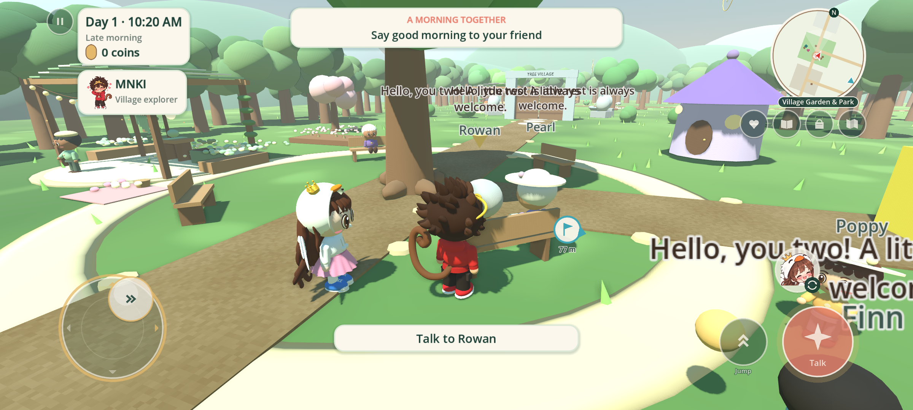
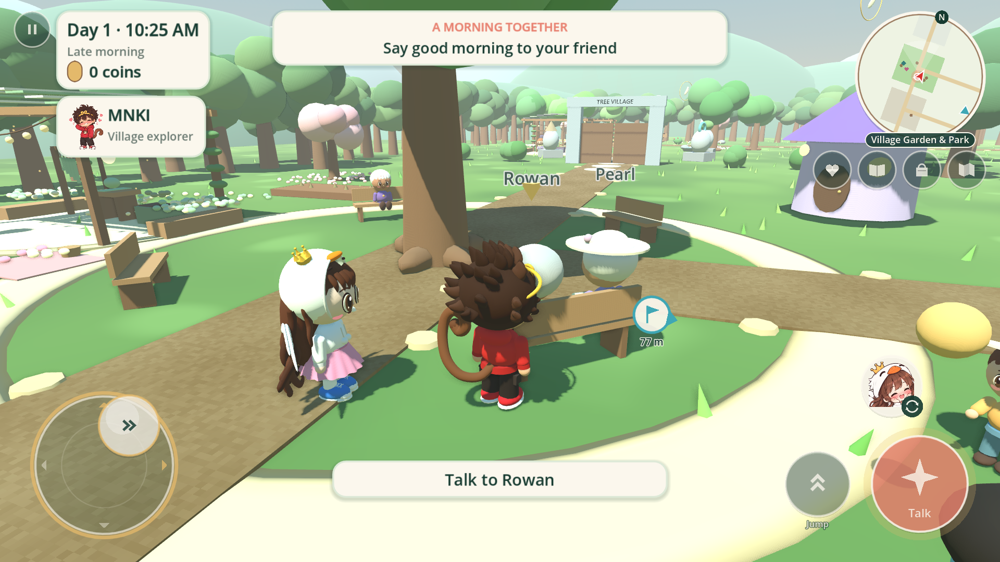
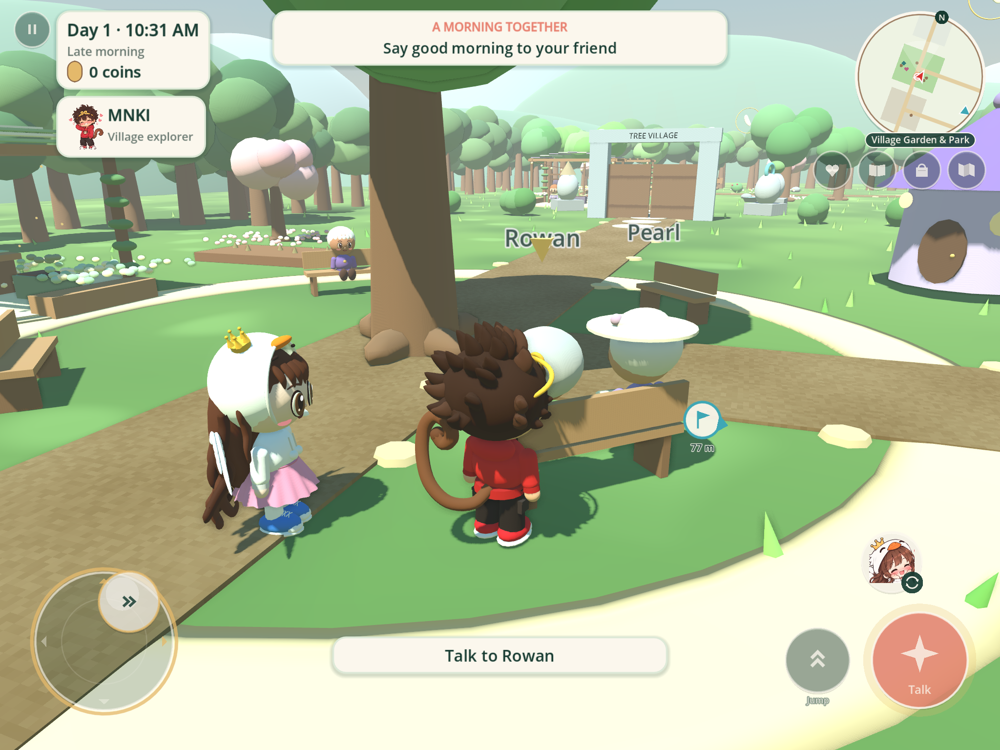
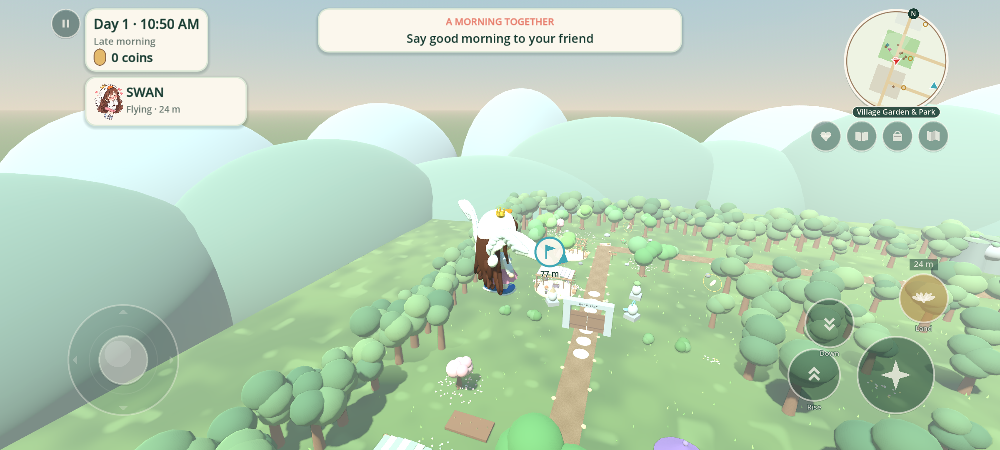
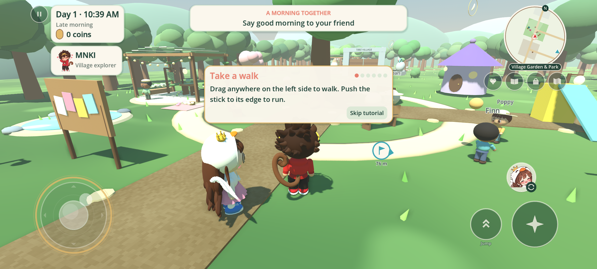

# Mobile & touch controls

MNKISWAN: Cozy World now plays on phones and tablets. Touch controls turn on automatically on Android/iOS, and on a desktop touchscreen the moment a finger touches the screen (typing on a keyboard switches back). Settings → **Touch & HUD** can force them on or off.

## Touch controls

| Control | What it does |
| --- | --- |
| Left side: floating joystick | Touch anywhere on the lower-left to drop the stick under your thumb. Half push walks; push to the gold rim to run. Drag far past the rim and the stick follows your thumb. |
| Right side: swipe | Turn the camera. Two fingers: pinch to zoom. |
| Big coral button | Talk, gather, farm, fish. It glows gold when something is in reach and shows the verb ("Talk", "Water", "Reel!"). |
| Jump / Rise | Jump on foot; hold to climb while Swan is flying. |
| Down | Hold to descend (only while flying). |
| Portrait button | Switch to your friend (shows whoever you will become). |
| Fly / Land / Hover | Swan only: take off, land, or hover. Altitude is shown above it. |
| Seed | Change seed (only when you carry seeds). |
| Row under the minimap | Shared moments, journal, bag, and map. |
| Pause (top-left) | Pause menu. |
| Minimap | Tap it to open the full map. Tap the full map to drop your own pin; tap the pin again to remove it. |

Every button fires the same input actions as the keyboard, so fishing, flight, dialogue and rituals follow the same rules. Multi-touch works, so you can walk and jump at the same time. Holding the stick when a menu opens releases it, so the hero never keeps walking by mistake.

## Layout on any screen

- **Notch / punch-hole / gesture bar:** the HUD, buttons, joystick, minimap and waypoint arrows are kept inside the display's safe area.
- **Any aspect ratio:** 16:9, 19.5:9, 20:9 and 4:3 tablets reflow live (see the screenshots below). The game locks to landscape, either way up.
- **Physical size:** on phones the buttons scale with screen density so they stay thumb-sized on small and large screens alike. The main button is about 11 mm wide on a typical phone.
- **Readability:** the HUD gets a 15% boost on touch screens, menu buttons get taller tap targets, and key hints ("press E") become touch wording.
- **Options:** button size, opacity, swipe sensitivity, edge-to-run, vibration, minimap on/off and rotation, waypoints on/off, and **Replay tutorial**.

| 16:9 phone | 4:3 tablet |
| --- | --- |
|  |  |

## Minimap, waypoints and pins

- A **round minimap** (top-right) shows regions, paths, the stream, villagers, Swan, gathering places, shared-ritual hearts, and sky feathers when you play as Swan. It turns with the camera, so up is always the way you are facing; an **N** badge on the rim marks north.
- **Waypoints:** the tracked quest has a coral pin, and your own pin is teal. On screen, the pin floats over the goal with its distance. Off screen, it slides to the edge as an arrow, staying clear of the thumb zones on phones. A soft light beam rises from each goal in the world and fades as you arrive. Your own pin clears itself when you reach it.

## First-play tutorial

Six short steps run on the first visit: walk, look, follow the pin, say hello, menus, and switch to Swan and fly. Each step finishes when you actually do it, highlighted with a pulsing ring around the right control. A **Next** button appears after a few seconds, and **Skip tutorial** is always there. The wording adapts to touch or keyboard. It never blocks input and hides while menus or dialogue are open.

## Building for Android

An **Android** export preset is included (arm64, immersive mode, vibrate permission, ETC2/ASTC textures). Install the Godot 4.7.2 Android export templates and Android SDK/JDK as described in Godot's documentation, set up a keystore, then export from **Project → Export → Android**. Mobile overrides lower shadow-map size and filter quality for phone GPUs. An iOS preset is not included; add one from the Export dialog on a Mac.

## Verification

- `tests/mobile_ui.tscn` contains **64 checks** for a simulated phone with notch insets. They cover the joystick, deadzone, speed matching, edge sprint, drag-follow, swipe-look, pinch, walking and jumping together, swapping, flying, landing, interacting, every menu button, release when a menu opens, safe-area layout, button overlap, minimap tap and passthrough, waypoint markers, beams, pins, map tap-to-pin, tutorial progression and skip, and the desktop auto-off behavior.
- `tests/mobile_gallery.tscn` renders 20:9 (notched), 16:9, 4:3 and desktop, checking that no button or HUD block leaves the safe area or overlaps another.

These are simulated devices, not real phones. On-device testing should still check performance, real safe-area values and DPI reporting.
