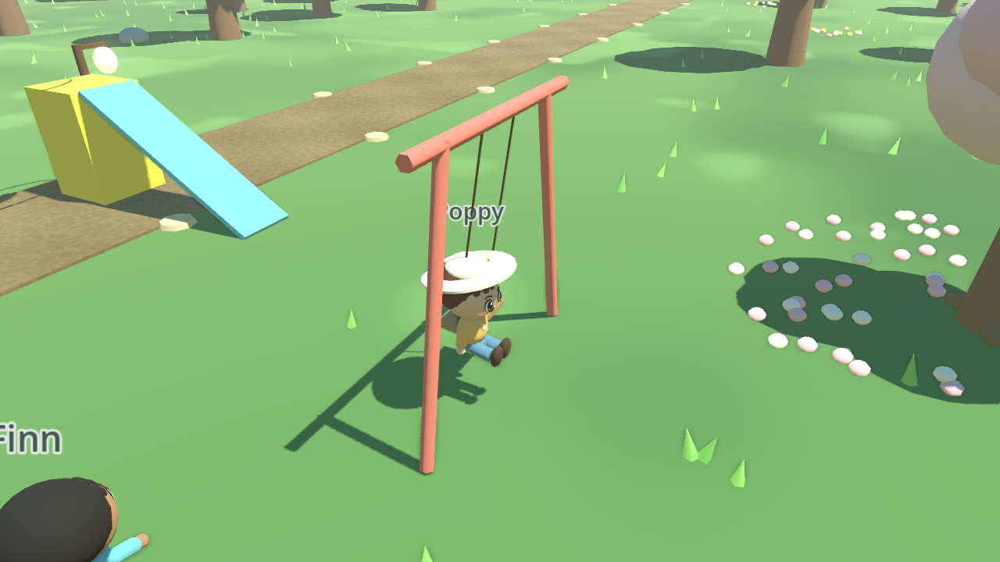
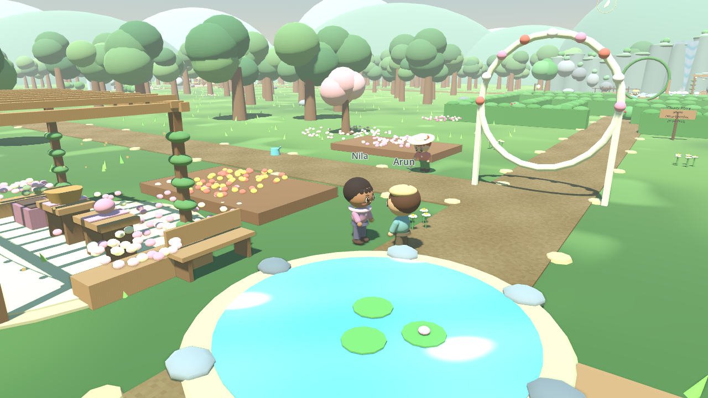
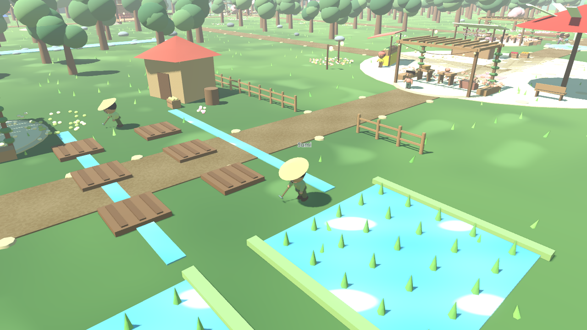
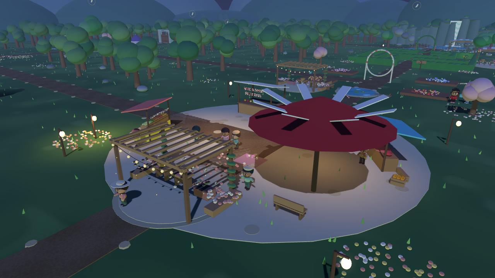
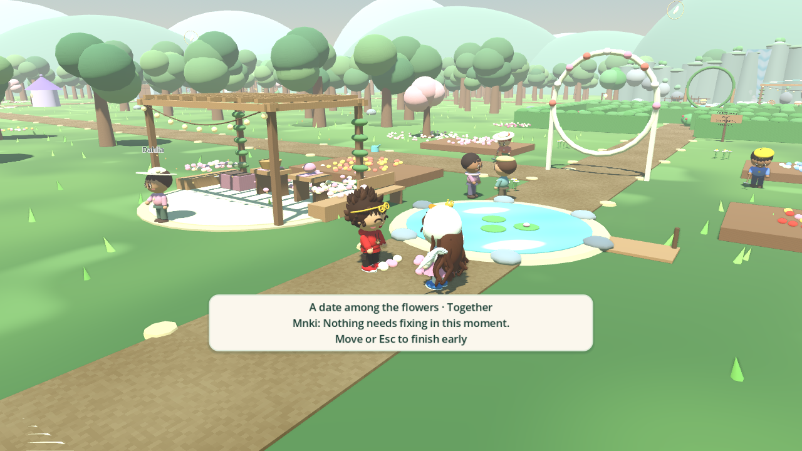
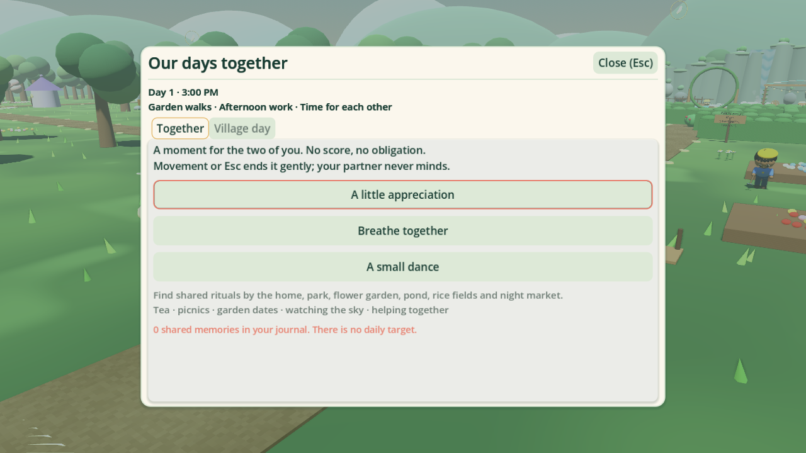
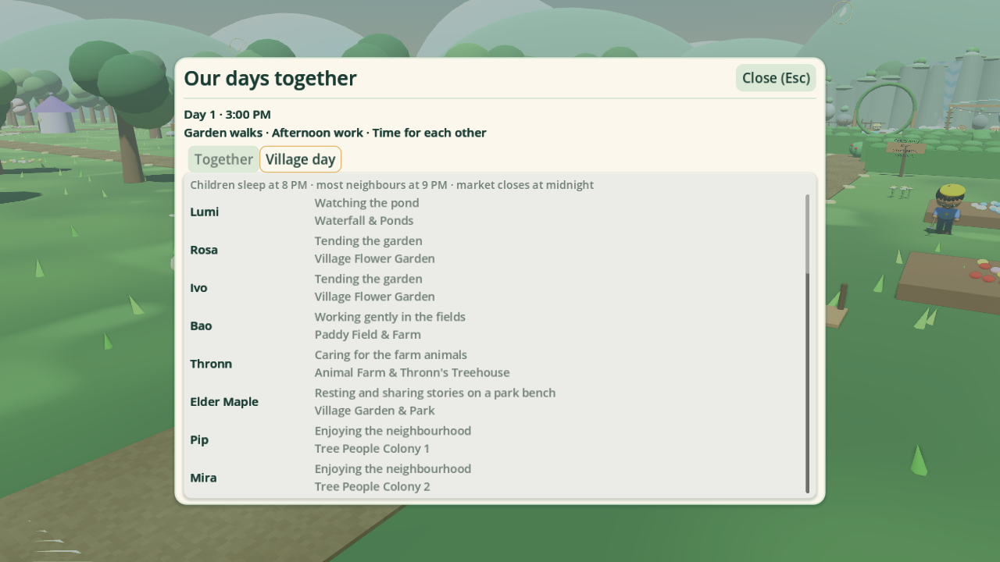
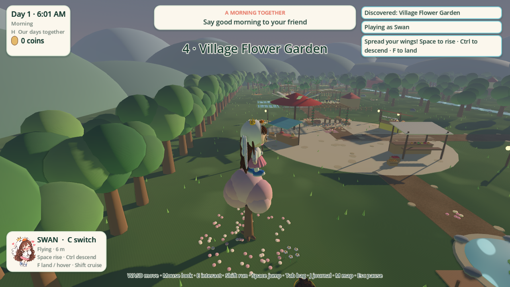

# Days Together — rendered game captures

These are actual Godot 4.7.2 / OpenGL captures, not concept art. The review camera provides a clear view of placement; the game uses its normal third-person camera.

## Park: children playing, elders on benches

## Poppy on the swing

## Nila and Arun in the garden

## Working fields

## Lantern market after household bedtime

## Mnki and Swan's shared garden moment

## Together and Village day UI

## Native Linux build: Swan in flight

