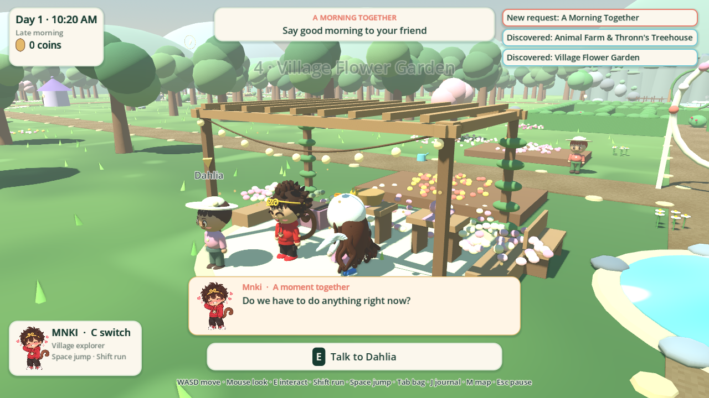
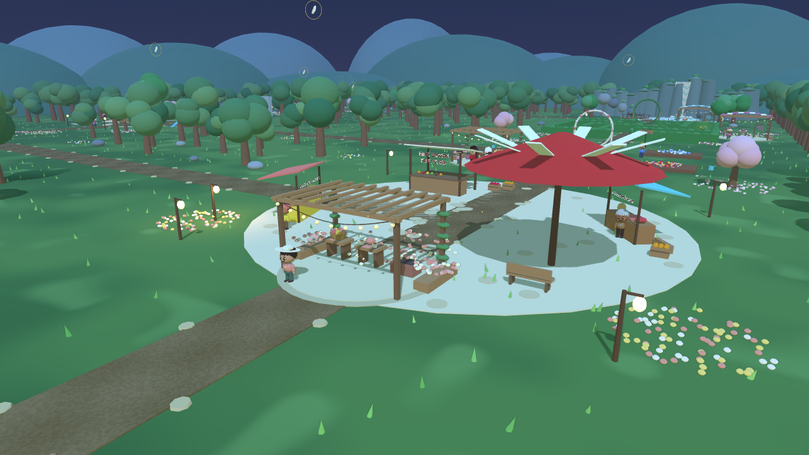

# Living Village — engine screenshots

These are actual Godot 4.7.2 renders. Region overviews use a review camera and staged character positions. The conversation view uses the actual non-modal subtitle UI. The evening scene shows completed activity props.

| Region | Screenshot |
| --- | --- |
| Sunshine Forest | [View](life_sunshine_forest.png) |
| Waterfall Ponds | [View](life_waterfall_ponds.png) |
| Berry Maze | [View](life_berry_maze.png) |
| Flower Garden | [View](life_flower_garden.png) |
| Paddy Field | [View](life_paddy_field.png) |
| Tropical Forest | [View](life_tropical_forest.png) |
| Animal Farm | [View](life_animal_farm.png) |
| Guardian Gate | [View](life_guardian_gate.png) |
| Village Park | [View](life_village_park.png) |
| Treehouse | [View](life_treehouse.png) |
| Colony One | [View](life_colony_one.png) |
| Colony Two | [View](life_colony_two.png) |
| Market Square | [View](life_market_square.png) |
